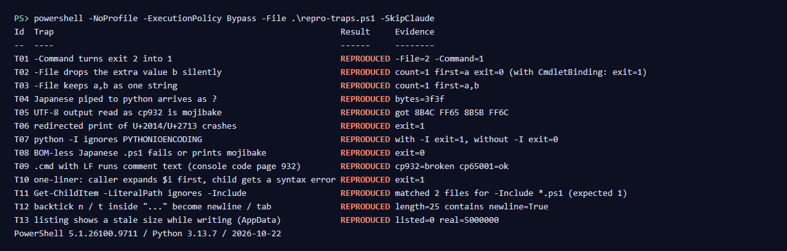

# claude-code-windows-traps

A script that deliberately triggers 14 traps where Claude Code automation on Windows **breaks without an error**, and prints which ones happen on your machine. Read-only except for files under `tmp\traps` next to the script. Also packaged as a Claude Code plugin (`cc-win-traps`) with one skill, `win-traps-check`.



*Output on the author's machine (Japanese Windows 11, code page 932). Results differ by machine: on English Windows, T09 did not break.*

日本語: [README.ja.md](README.ja.md)

## Use it as a Claude Code plugin

```
/plugin marketplace add cart231-ffly-b/claude-code-windows-traps
/plugin install cc-win-traps@cc-win-traps
```

Then ask Claude, for example:

- "Which of the Windows traps happen on this machine?"
- "My script works when I run it by hand but fails in Task Scheduler. Check the Windows traps."
- "Japanese text I pipe into python arrives as ??. Is that one of the known traps?"

The skill runs the script with `-SkipSlow -SkipClaude`, shows a table, and gives the one-line fix for each trap that reproduced. It does not change your files.

## Use it without the plugin

Needs Windows PowerShell 5.1 and Python (T14 also calls `claude`).

```powershell
powershell -NoProfile -ExecutionPolicy Bypass -File .\repro-traps.ps1
```

- `-SkipSlow` skips T13 (watching the size of a file being written, a few seconds)
- `-SkipClaude` skips T14 (calls `claude`)

`REPRODUCED` means the trap happened on your machine. **Run it with `-File`**: calling it through `-Command` steps on T01 itself.

## The 14 traps

| Id | What breaks | Author's machine |
| --- | --- | --- |
| T01 | `exit 2` becomes `1` through `-Command` | `-File=2 -Command=1` |
| T02 | `-File` with `-Path a b` silently drops `b` | `count=1`, exit 0 |
| T03 | `-File` with `-Path a,b` gives one string | `first=a,b` |
| T04 | non-ASCII piped to a native program arrives as `?` | bytes `3f3f` |
| T05 | UTF-8 output read with the default code page is mojibake | 2 characters became 4 others |
| T06 | Python crashes only when redirected | UnicodeEncodeError, exit 1 |
| T07 | `python -I` ignores `PYTHONIOENCODING` | 1 with `-I`, 0 without |
| T08 | a non-ASCII `.ps1` without BOM | output differs from source |
| T09 | a `.cmd` with LF line endings runs its comments | `cp932=broken cp65001=ok` |
| T10 | a one-liner: the caller expands `$i` first | syntax error, exit 1 |
| T11 | `-Include` is ignored with `-LiteralPath` | the `.md` came back too |
| T12 | backticks inside `"..."` become newlines or tabs | a newline appeared |
| T13 | a file being written shows 0 bytes (under AppData) | listed 0, actual 5,000,000 |
| T14 | `claude -p --allowedTools X "prompt"` swallows the prompt | `Input must be provided ...` |

Author's machine: Windows 11 / Windows PowerShell 5.1.26100 / Python 3.13.7 / Claude Code 2.1.304, Japanese Windows (code page 932), checked 2026-10-20/21.

**Results differ on English Windows (1252 / 437).** T09 did not break there. T05, T06 and T09 test with your machine's own default code page.

**Python 3.15 (released 2026-10-09) makes UTF-8 the default (PEP 686).** On 3.15 or later, T06 and T07 are expected to show NOT REPRODUCED. The author's machine runs 3.13; with `-X utf8` (UTF-8 mode, the 3.15 default) the same script did not crash.

## Fixes

| Id | One-line fix |
| --- | --- |
| T01 | Call scripts with `-File`, or end `-Command` with `; exit $LASTEXITCODE` |
| T02 | Add `[CmdletBinding()]` so an extra argument stops with an error |
| T03 | Accept one string and split it yourself with `-split ','` |
| T04 | Write long text to a UTF-8 file and pass an ASCII instruction; set `$OutputEncoding` to UTF-8 |
| T05 | Set `[Console]::OutputEncoding = [Text.Encoding]::UTF8` on the reading side |
| T06 | Set `PYTHONIOENCODING=utf-8` on the sending side |
| T07 | Drop `-I`, or call `sys.stdout.reconfigure(encoding="utf-8")` in the script |
| T08 | Save `.ps1` files as UTF-8 with BOM, or keep them ASCII-only |
| T09 | Save `.cmd` / `.bat` files with CRLF line endings |
| T10 | Put the logic in a `.ps1` and run it with `-File` |
| T11 | Filter extensions with `Where-Object` instead of `-Include` |
| T12 | Use single-quoted here-strings (`@'...'@`) for text with backticks |
| T13 | Open the file and read its length before concluding it is empty |
| T14 | Send the prompt on stdin, not as a positional argument |

A longer write-up (Japanese, free): https://note.com/sodateru_ai/n/na7d9ee2a36fa

## Troubleshooting

- **"running scripts is disabled on this system"**: keep `-ExecutionPolicy Bypass` in the command.
- **`CANNOT CHECK` on T04–T07 and T13**: these need a real Python. The script shows this when `python` is not on PATH or only the Microsoft Store stub answers (it prints nothing and exits 9009). Install Python 3 from python.org and run again.
- **Everything looks fine but your scheduled job still fails**: run the job's exact command line once by hand with `-File`, and compare the exit code with what Task Scheduler shows.
- **The table is mojibake**: run it from Windows PowerShell 5.1, not from a shell that re-encodes output.

## Privacy

- This plugin collects, stores and sends no personal data. It makes no network requests and has no telemetry.
- The skill runs only the bundled `repro-traps.ps1`, with `-SkipSlow -SkipClaude`. In that mode the script writes only small test files under `tmp\traps` next to itself (deleted and recreated on each run), and sets `PYTHONIOENCODING` inside its own process for one test before restoring it. It does not change system settings, the registry or any of your files.
- Run by hand without `-SkipSlow`, one extra test writes a 5 MB file to `%LOCALAPPDATA%\cc-win-kit-trap` and deletes it at the end. Without `-SkipClaude`, it runs `claude -p "say hi"` once through your own Claude Code.
- Results are printed to the console only.

## Related

The author also sells **cc-win-kit** ($19), which adds a write guard for Claude Code, an unattended runner and a doctor that scans your files for these traps: https://payhip.com/b/bRnDJ . This repository works on its own without it.

## License

MIT ([LICENSE](LICENSE)).
